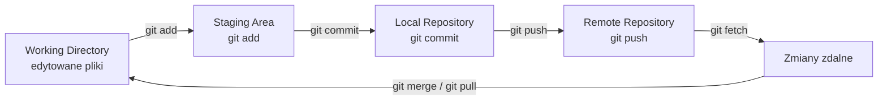
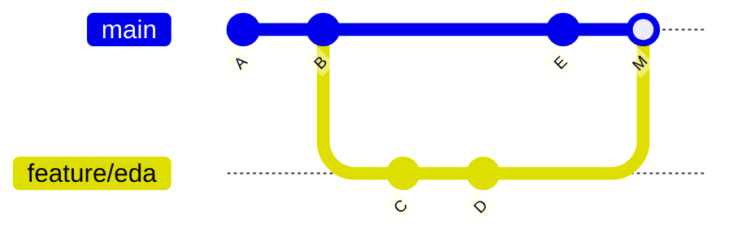

# Przewodnik Git i Git w Visual Studio Code

> **Praktyczny podręcznik dla Windows 11, PowerShell, Visual Studio Code, GitHub oraz projektów Python / Data Analytics / Machine Learning.**

### Oznaczenia

- **Bezpieczne** – zwykle nie usuwa istniejącej historii ani pracy.
- **Uwaga** – może zmienić stan repozytorium lub nadpisać pliki.
- **Destrukcyjne** – może bezpowrotnie usunąć lokalne zmiany lub zmienić opublikowaną historię.
- **Ćwiczenie** – wykonaj operację samodzielnie w testowym repozytorium.

### Spis treści

1. [Podstawy Git i kontroli wersji](#1-podstawy-git-i-kontroli-wersji)
2. [Konfiguracja Git i pierwsze repozytorium](#2-konfiguracja-git-i-pierwsze-repozytorium)
3. [Codzienna praca – najważniejsze komendy](#3-codzienna-praca--najważniejsze-komendy)
4. [Branching – praca z gałęziami](#4-branching--praca-z-gałęziami)
5. [GitHub i repozytoria zdalne](#5-github-i-repozytoria-zdalne)
6. [Git w Visual Studio Code](#6-git-w-visual-studio-code)
7. [Git Graph, GitLens i Git History](#7-git-graph-gitlens-i-git-history)
8. [Operacje zaawansowane i odzyskiwanie zmian](#8-operacje-zaawansowane-i-odzyskiwanie-zmian)
9. [Git w projektach Python, Jupyter i ML](#9-git-w-projektach-python-jupyter-i-ml)
10. [Ściąga, dobre praktyki i typowe problemy](#10-ściąga-dobre-praktyki-i-typowe-problemy)
11. [Projekt końcowy – kompletny workflow](#11-projekt-końcowy--kompletny-workflow)
12. [Źródła i dalsza dokumentacja](#12-źródła-i-dalsza-dokumentacja)

---

# 1. Podstawy Git i kontroli wersji

## 1.1. Czym jest Git?

Git to rozproszony system kontroli wersji (Distributed Version Control System, DVCS). Pozwala rejestrować zmiany w plikach, wracać do wcześniejszych wersji, rozwijać kilka wariantów projektu równolegle i łączyć pracę wielu osób.

Git działa lokalnie. Do tworzenia commitów nie jest potrzebny GitHub ani połączenie z Internetem. GitHub jest usługą hostingową, która może przechowywać zdalne repozytorium Git i udostępniać funkcje współpracy.

### Git a GitHub

| Git | GitHub |
|---|---|
| Program / system kontroli wersji | Platforma internetowa |
| Działa lokalnie | Hostuje repozytoria zdalne |
| Tworzy commity i gałęzie | Udostępnia Pull Requesty, Issues, przegląd kodu |
| Może działać bez Internetu | Wymaga połączenia do synchronizacji |
| Nie jest zależny od konkretnego hostingu | Obsługuje repozytoria Git |

Inne platformy hostujące repozytoria Git to m.in. GitLab, Bitbucket i Azure Repos.

## 1.2. Repozytorium

Repozytorium (repository, repo) to katalog projektu, którego historię zmian kontroluje Git. Po wykonaniu `git init` w katalogu pojawia się ukryty katalog `.git`. Zawiera on m.in. historię, konfigurację repozytorium, referencje do commitów i informacje potrzebne Gitowi do działania.

Nie należy ręcznie modyfikować zawartości `.git`.

Repozytorium może być:

- **lokalne** – znajduje się na komputerze;
- **zdalne** – znajduje się na serwerze, np. GitHub;
- **sklonowane** – lokalna kopia istniejącego repozytorium z konfiguracją zdalnego źródła.

## 1.3. Cztery obszary pracy z Git

To najważniejszy model pojęciowy w Git.

1. **Working Directory (katalog roboczy)** – aktualne pliki, które edytujesz.
2. **Staging Area / Index (poczekalnia)** – zmiany wybrane do następnego commita.
3. **Local Repository (repozytorium lokalne)** – zapisane commity i historia.
4. **Remote Repository (repozytorium zdalne)** – repozytorium na serwerze, np. GitHub.



Schemat jest uproszczony. `git fetch` aktualizuje lokalne referencje do gałęzi zdalnych, ale sam nie scala zmian z aktualną gałęzią. `git pull` wykonuje pobranie i integrację.

### Przykład

Edytujesz `analysis.py`:

- po zapisaniu pliku zmiana znajduje się w Working Directory;
- po `git add analysis.py` wybrana wersja trafia do Staging Area;
- po `git commit` powstaje lokalny commit;
- po `git push` commit zostaje wysłany do zdalnego repozytorium.

**Ważne:** `git add` zapisuje do staging area stan pliku z chwili wykonania polecenia. Jeśli później ponownie zmienisz plik, te nowe zmiany nie będą automatycznie staged.

## 1.4. Commit

Commit to zapis określonego zestawu zmian w historii repozytorium. Można go traktować jak punkt kontrolny projektu.

Każdy commit ma m.in.:

- unikalny identyfikator (hash);
- autora i osobę zapisującą commit;
- datę;
- komunikat opisujący zmianę;
- odniesienie do jednego lub kilku commitów nadrzędnych.

Dobry commit powinien być możliwie spójny i opisywać jedną logiczną zmianę.

Przykłady dobrych komunikatów:

```text
Add missing-value analysis to EDA notebook
Fix date parsing in preprocessing
Update project dependencies
Add baseline logistic regression
```

Unikaj komunikatów typu `zmiany`, `poprawki`, `test`, `update` – nie wyjaśniają, co zostało zmienione.

## 1.5. Branch, HEAD, main i origin

- **Branch (gałąź)** – ruchoma nazwa wskazująca na commit. Umożliwia rozwój funkcji niezależnie od głównej linii projektu.
- **main** – często używana nazwa głównej gałęzi. W starszych repozytoriach może występować `master`.
- **HEAD** – wskazuje, na jakiej rewizji / gałęzi aktualnie pracujesz. Zwykle wskazuje na aktualną gałąź.
- **origin** – domyślna nazwa zdalnego repozytorium dodawanego podczas klonowania. To konwencja, nie specjalne słowo wymagane przez Git.
- **upstream** – często nazwa repozytorium źródłowego, z którego utworzono fork. Może też oznaczać skonfigurowaną gałąź śledzoną – znaczenie zależy od kontekstu.

## 1.6. Jak działa historia commitów?

Commity tworzą graf skierowany. Każdy commit (poza początkowym) wskazuje na swojego rodzica. Gałęzie są nazwami wskazującymi na konkretne commity.



Nie należy mylić gałęzi z osobnym, fizycznym katalogiem projektu. Gałąź jest przede wszystkim referencją do commita. Przełączenie gałęzi zmienia widok plików w katalogu roboczym na stan wynikający z wybranego commita.


# 2. Konfiguracja Git i pierwsze repozytorium

## 2.1. Sprawdzenie instalacji

W terminalu PowerShell:

```powershell
git --version
```

Przykładowy wynik:

```text
git version 2.56.0.windows.4
```

Wersja wyświetlona na komputerze może być inna.

Jeśli polecenie nie jest rozpoznawane:

1. sprawdź, czy Git for Windows jest zainstalowany;
2. zamknij i ponownie otwórz terminal / VS Code;
3. sprawdź, czy Git znajduje się w zmiennej środowiskowej `PATH`;
4. w VS Code sprawdź ustawienie `git.path`, jeśli Git nie jest wykrywany automatycznie.

## 2.2. Konfiguracja użytkownika

Git zapisuje autora commita na podstawie konfiguracji.

```bash
git config --global user.name "Imię Nazwisko"
git config --global user.email "adres@example.com"
```

Adres e-mail powinien być zgodny z adresem dodanym do konta GitHub albo z adresem prywatnym GitHub, jeśli nie chcesz publikować osobistego adresu.

Sprawdzenie:

```bash
git config --global --list
git config --global user.name
git config --global user.email
```

Zakresy konfiguracji:

| Zakres | Parametr | Zastosowanie |
|---|---|---|
| Systemowy | `--system` | Ustawienia dla całego komputera |
| Globalny | `--global` | Ustawienia użytkownika |
| Lokalny | `--local` | Ustawienia konkretnego repozytorium |

Konfiguracja lokalna ma pierwszeństwo przed globalną. Możesz ustawić inny e-mail dla konkretnego repozytorium:

```bash
git config --local user.email "inny-adres@example.com"
```

## 2.3. Inne przydatne ustawienia

```bash
git config --global init.defaultBranch main
git config --global core.autocrlf true
```

- `init.defaultBranch main` ustawia domyślną nazwę gałęzi dla nowych repozytoriów.
- `core.autocrlf true` jest typowym ustawieniem na Windows, które pomaga obsługiwać różnice zakończeń linii między Windows i systemami Unix. W zespołach warto dodatkowo ustalić reguły w `.gitattributes`.

Sprawdź ustawienia:

```bash
git config --global --list
```

Nie kopiuj bezrefleksyjnie cudzych ustawień Git – powinny odpowiadać sposobowi pracy i standardom projektu.

## 2.4. Inicjalizacja repozytorium

W terminalu przejdź do katalogu projektu:

```powershell
cd "$HOME\Desktop"
mkdir git-lab
cd git-lab
git init
```

Git utworzy repozytorium w bieżącym katalogu.

Sprawdź:

```bash
git status
```

W VS Code:

1. Otwórz katalog `git-lab` (`File → Open Folder`).
2. Otwórz panel Source Control (`Ctrl+Shift+G`).
3. Jeśli katalog nie był repozytorium, wybierz `Initialize Repository`.
4. Sprawdź, czy pojawiła się gałąź `main` lub inna skonfigurowana nazwa.

## 2.5. Klonowanie repozytorium

`git clone` tworzy lokalną kopię istniejącego repozytorium:

```bash
git clone https://github.com/OWNER/REPOSITORY.git
```

Przykładowy adres jest schematyczny – zastąp go rzeczywistym adresem repozytorium.

Klonowanie zwykle:

- pobiera historię repozytorium;
- tworzy katalog projektu;
- konfiguruje zdalne repozytorium pod nazwą `origin`;
- ustawia lokalną gałąź śledzącą odpowiednią gałąź zdalną.

## 2.6. Plik `.gitignore`

`.gitignore` określa, które nieśledzone pliki i katalogi Git ma pomijać. Nie usuwa z repozytorium plików, które już są śledzone.

Przykładowy początek `.gitignore` dla Pythona:

```gitignore
# Python
__pycache__/
*.py[cod]
*.pyd
.venv/
venv/

# Jupyter
.ipynb_checkpoints/

# Środowisko i sekrety
.env
.env.*
!.env.example

# VS Code – lokalne ustawienia użytkownika
.vscode/

# Dane i artefakty – dostosuj do projektu
data/raw/
data/processed/
models/
reports/figures/

# Pliki systemowe
.DS_Store
Thumbs.db
```

To tylko punkt wyjścia. Nie ignoruj automatycznie całych katalogów `models/`, `reports/` lub `data/`, jeśli projekt wymaga wersjonowania wybranych małych plików, wyników lub przykładowych danych. Można ignorować katalog i jawnie dopuścić wybrane pliki.

Przydatne polecenie:

```bash
git check-ignore -v data/raw/dataset.csv
```

Pokazuje, która reguła `.gitignore` ignoruje wskazany plik.

### Plik już śledzony, ale powinien być ignorowany

Jeśli plik został wcześniej dodany do repozytorium, dopisanie go do `.gitignore` nie przestanie go śledzić.

Można usunąć go ze śledzenia, pozostawiając lokalny plik:

```bash
git rm --cached nazwa_pliku
git commit -m "Stop tracking generated file"
```

**Uwaga:** `git rm --cached` usuwa plik z indeksu, a nie z dysku. Po commicie plik nie będzie już śledzony.

## 2.7. README.md

README opisuje projekt i pomaga innym zrozumieć, jak go uruchomić.

Przykładowa struktura:

```markdown
# HR Analytics – Machine Learning

## Cel projektu
Predykcja zmiany pracy na podstawie danych HR.

## Technologie
- Python
- pandas
- scikit-learn
- Jupyter

## Instalacja
uv sync

## Uruchomienie
Otwórz notebook z katalogu `notebooks/`.

## Struktura projektu
Opis najważniejszych katalogów.

## Dane
Informacja o źródle danych i zasadach dostępu.
```

Nie umieszczaj w README haseł, tokenów API, danych osobowych ani poufnych informacji.


# 3. Codzienna praca – najważniejsze komendy

To rozdział, do którego najczęściej będziesz wracać.

## 3.1. `git status` – kontrola stanu repozytorium

```bash
git status
git status --short
```

Pokazuje m.in.:

- aktualną gałąź;
- zmodyfikowane pliki;
- pliki staged;
- pliki nieśledzone;
- informację o rozbieżności z gałęzią zdalną.

Wersja skrócona (`--short`) używa oznaczeń:

| Oznaczenie | Znaczenie |
|---|---|
| `??` | Plik nieśledzony |
| ` M` | Zmiana w katalogu roboczym |
| `M ` | Zmiana w staging area |
| `MM` | Plik staged i ponownie zmieniony w katalogu roboczym |
| `A ` | Nowy plik dodany do staging area |
| `D ` | Plik usunięty i staged |

Pierwsza kolumna dotyczy staging area, druga – katalogu roboczego.

**Dobra praktyka:** wykonuj `git status` przed i po ważniejszych operacjach. To najprostszy sposób kontroli tego, co faktycznie zamierzasz zapisać.

## 3.2. `git add` – staging area

Dodanie jednego pliku:

```bash
git add analysis.py
```

Dodanie kilku plików:

```bash
git add analysis.py preprocessing.py README.md
```

Dodanie wszystkich zmian w bieżącym katalogu i podkatalogach:

```bash
git add .
```

Dodanie wszystkich zmian śledzonych i nieśledzonych w repozytorium:

```bash
git add -A
```

Interaktywne wybieranie fragmentów zmian:

```bash
git add -p
```

`git add -p` pozwala wybrać konkretne fragmenty (hunks) pliku. Jest przydatne, gdy w jednym pliku znajdują się zmiany należące do różnych commitów.

### `git add .` czy `git add -A`?

- `git add .` obejmuje zmiany w bieżącym katalogu i jego podkatalogach.
- `git add -A` obejmuje zmiany w całym repozytorium, niezależnie od bieżącego podkatalogu.

Przed commitem sprawdź staging area:

```bash
git diff --cached
```

## 3.3. `git commit` – zapis zmian

```bash
git commit -m "Add initial data validation"
```

Commit zapisuje zmiany znajdujące się w staging area.

Przydatne warianty:

```bash
git commit
git commit -am "Update preprocessing"
```

`git commit -am` automatycznie dodaje zmiany w plikach już śledzonych i tworzy commit. **Nie dodaje nowych, nieśledzonych plików.**

Nie używaj `-am`, jeśli chcesz świadomie wybrać tylko część zmian albo dodać nowe pliki.

## 3.4. `git log` – historia commitów

```bash
git log
git log --oneline
git log --oneline --graph --decorate --all
```

Przydatne opcje:

| Polecenie | Zastosowanie |
|---|---|
| `git log --oneline` | Skrócona historia |
| `git log --graph` | Graf historii |
| `git log --all` | Wszystkie widoczne gałęzie |
| `git log -5` | Ostatnie 5 commitów |
| `git log --stat` | Statystyki zmian w commitach |
| `git log -- path/to/file.py` | Historia konkretnego pliku |

## 3.5. `git diff` – porównywanie zmian

```bash
git diff
```

Porównuje Working Directory ze Staging Area, czyli pokazuje zmiany jeszcze niestaged.

```bash
git diff --staged
```

Porównuje Staging Area z ostatnim commitem.

```bash
git diff HEAD
```

Pokazuje łączną różnicę między katalogiem roboczym / indeksem a aktualnym commitem.

Porównanie dwóch commitów:

```bash
git diff COMMIT_A COMMIT_B
```

Porównanie gałęzi:

```bash
git diff main feature/eda
```

## 3.6. `git restore` – przywracanie plików

Przywrócenie pliku do stanu z ostatniego commita:

```bash
git restore analysis.py
```

Usuwa niezacommitowane zmiany w katalogu roboczym wskazanego pliku.

Usunięcie pliku ze staging area, ale pozostawienie zmian w katalogu roboczym:

```bash
git restore --staged analysis.py
```

Przywrócenie pliku do stanu z commita:

```bash
git restore --source=HEAD~1 analysis.py
```

**Destrukcyjne:** zwykłe `git restore plik` może usunąć niezacommitowane zmiany w tym pliku. Najpierw obejrzyj `git diff` lub wykonaj kopię.

## 3.7. `git rm` – usuwanie plików

Usunięcie pliku z dysku i ze śledzenia Git:

```bash
git rm old_file.csv
```

Usunięcie pliku wyłącznie ze śledzenia, bez kasowania lokalnego pliku:

```bash
git rm --cached config.local
```

Po operacji wykonaj commit, aby zmiana została zapisana w historii.

## 3.8. `git mv` – zmiana nazwy lub przeniesienie

```bash
git mv old_name.py new_name.py
```

Git wykrywa zmianę nazwy na podstawie podobieństwa zawartości przy analizie historii. Nie istnieje osobny typ obiektu „rename” w modelu commitów – jest to sposób prezentacji zmian.

## 3.9. `git stash` – tymczasowe odkładanie zmian

Przydaje się, gdy musisz na chwilę przerwać pracę, ale nie chcesz jeszcze tworzyć commita.

```bash
git stash push -m "WIP: EDA"
git stash list
git stash apply
git stash pop
git stash drop
```

| Polecenie | Działanie |
|---|---|
| `stash push` | Odkłada zmiany |
| `stash list` | Pokazuje zapisane schowki |
| `stash apply` | Przywraca zmiany, zachowując wpis stash |
| `stash pop` | Przywraca i usuwa wpis, jeśli operacja się powiedzie |
| `stash drop` | Usuwa wybrany wpis |
| `stash clear` | Usuwa wszystkie wpisy stash |

Domyślnie stash obejmuje zmiany śledzonych plików. Aby dołączyć pliki nieśledzone:

```bash
git stash push -u -m "WIP with untracked files"
```

**Uwaga:** stash nie zastępuje regularnych commitów. Nie traktuj go jako trwałego archiwum.

## 3.10. `git show` – szczegóły commita

```bash
git show
git show --stat
git show COMMIT_HASH
git show COMMIT_HASH -- analysis.py
```

Pozwala zobaczyć metadane commita i zapisane w nim zmiany.

## 3.11. `git clean` – usuwanie nieśledzonych plików

Najpierw sprawdź, co zostałoby usunięte:

```bash
git clean -n
```

Usunięcie nieśledzonych plików:

```bash
git clean -f
```

Usunięcie także nieśledzonych katalogów:

```bash
git clean -fd
```

**Destrukcyjne:** `git clean` usuwa pliki z dysku. Nie korzystaj z niego bez wcześniejszego sprawdzenia wyniku `git clean -n`. Opcja `-x` obejmuje również pliki ignorowane przez `.gitignore` – stosuj ją wyjątkowo ostrożnie.


# 4. Branching – praca z gałęziami

## 4.1. Dlaczego używać branchy?

Gałęzie pozwalają pracować nad funkcjami, poprawkami lub eksperymentami bez bezpośredniej ingerencji w główną linię projektu.

Przykładowe nazwy:

```text
main
feature/eda
feature/model-training
fix/missing-values
docs/update-readme
```

Nazwy powinny być krótkie i opisywać cel gałęzi.

## 4.2. Tworzenie i przeglądanie gałęzi

```bash
git branch
git branch -a
git branch feature/eda
```

- `git branch` – lokalne gałęzie;
- `git branch -a` – lokalne i zdalne gałęzie;
- `git branch feature/eda` – tworzy gałąź, ale nie przełącza na nią.

## 4.3. Przełączanie gałęzi

```bash
git switch main
git switch feature/eda
```

Utworzenie i natychmiastowe przełączenie:

```bash
git switch -c feature/eda
```

Starsza komenda `git checkout` również obsługuje przełączanie gałęzi, ale `git switch` jest bardziej jednoznaczna.

## 4.4. Łączenie gałęzi – merge

Przykład: zakończyłeś pracę na `feature/eda` i chcesz połączyć ją z `main`.

```bash
git switch main
git merge feature/eda
```

Merge może wykonać:

- **Fast-forward** – przesuwa wskaźnik gałęzi, jeśli nie powstała rozbieżna historia;
- **Three-way merge** – tworzy commit scalający na podstawie wspólnego przodka i dwóch linii zmian.

Wynik zależy od historii obu gałęzi i konfiguracji Git.

## 4.5. Konflikty merge

Konflikt pojawia się, gdy Git nie potrafi automatycznie połączyć zmian.

Przykładowy fragment pliku:

```text
<<<<<<< HEAD
Wersja z aktualnej gałęzi
=======
Wersja z łączonej gałęzi
>>>>>>> feature/eda
```

Znaczenie:

- `<<<<<<< HEAD` – początek fragmentu z aktualnej gałęzi;
- `=======` – separator;
- `>>>>>>> feature/eda` – koniec fragmentu z łączonej gałęzi.

Sposób rozwiązania:

1. Otwórz plik konfliktowy.
2. Przeczytaj obie wersje i zdecyduj, jaki ma być wynik.
3. Usuń znaczniki konfliktu.
4. Zapisz poprawną treść.
5. Sprawdź plik i testy.
6. Dodaj rozwiązany plik do staging area.
7. Dokończ merge.

```bash
git add konflikt.py
git status
git commit
```

Jeśli chcesz przerwać merge przed jego zakończeniem:

```bash
git merge --abort
```

## 4.6. Usuwanie gałęzi

Usunięcie lokalnej gałęzi:

```bash
git branch -d feature/eda
```

Wymuszenie usunięcia gałęzi, nawet jeśli nie została scalona:

```bash
git branch -D feature/eda
```

Usunięcie gałęzi zdalnej:

```bash
git push origin --delete feature/eda
```

`-D` może doprowadzić do utraty łatwo dostępnej referencji do niepołączonych commitów. Przed użyciem sprawdź historię.

# 5. GitHub i repozytoria zdalne

## 5.1. Czym jest remote?

Remote to nazwa i adres zdalnego repozytorium. Najczęściej używana nazwa to `origin`.

```bash
git remote -v
```

Dodanie zdalnego repozytorium:

```bash
git remote add origin https://github.com/OWNER/REPOSITORY.git
```

Zmiana adresu:

```bash
git remote set-url origin https://github.com/OWNER/REPOSITORY.git
```

Usunięcie konfiguracji remote:

```bash
git remote remove origin
```

Usunięcie remote nie kasuje repozytorium na serwerze.

## 5.2. `git fetch` – pobieranie informacji ze zdalnego repozytorium

```bash
git fetch origin
```

Pobiera nowe commity i aktualizuje lokalne referencje zdalne, np. `origin/main`. Nie scala ich automatycznie z lokalnym `main` i nie powinno nadpisywać Twoich lokalnych zmian w plikach.

Po `fetch` możesz obejrzeć różnice:

```bash
git log --oneline main..origin/main
git diff main origin/main
```

## 5.3. `git pull` – pobranie i integracja

```bash
git pull
```

`git pull` jest zasadniczo połączeniem `git fetch` i operacji integracji – zwykle merge, ale może być skonfigurowany rebase.

Bardziej jawnie:

```bash
git pull --no-rebase
git pull --rebase
```

Nie wykonuj `pull` bez zastanowienia, jeśli masz lokalne zmiany. Najpierw sprawdź `git status` i rozważ commit albo stash.

## 5.4. `git push` – wysyłanie commitów

```bash
git push
```

Przy pierwszym wysyłaniu nowej gałęzi:

```bash
git push -u origin feature/eda
```

`-u` ustawia gałąź zdalną jako upstream dla bieżącej gałęzi. Przy kolejnych synchronizacjach zwykle wystarczy `git push` i `git pull`.

## 5.5. Fetch, pull i push – porównanie

| Operacja | Kierunek | Co robi? |
|---|---|---|
| `fetch` | Zdalne → lokalne referencje | Pobiera commity i aktualizuje informacje o remote |
| `pull` | Zdalne → lokalna gałąź | Pobiera i integruje zmiany |
| `push` | Lokalna → zdalne | Publikuje lokalne commity |

## 5.6. HTTPS i SSH

GitHub obsługuje uwierzytelnianie m.in. przez HTTPS i SSH.

- **HTTPS** – często wygodne przy logowaniu przez menedżer poświadczeń / Git Credential Manager.
- **SSH** – wymaga wygenerowania klucza i dodania klucza publicznego do konta GitHub.

Nie wpisuj tokenów dostępu bezpośrednio w kodzie, skryptach, URL-ach zapisywanych w repozytorium ani komunikatach commitów.

Przy HTTPS nie należy używać zwykłego hasła konta GitHub jako hasła Git. Stosuj aktualnie wspierany mechanizm uwierzytelniania, np. Git Credential Manager lub token zgodnie z instrukcjami GitHub.

## 5.7. Typowy workflow z GitHub

```bash
git status
git add .
git commit -m "Add EDA summary"
git pull --rebase
git push
```

To przykład, nie uniwersalna sekwencja. Jeśli pracujesz samodzielnie i masz poprawnie zsynchronizowaną gałąź, `pull` może nie być potrzebny przed każdym `push`. W pracy zespołowej synchronizuj się zgodnie z przyjętym procesem.

## 5.8. Pull Request (PR)

Pull Request to mechanizm platformy hostingowej, np. GitHub, służący do zaproponowania połączenia zmian z jednej gałęzi do drugiej.

Typowy przebieg:

1. Utwórz branch.
2. Wprowadź zmiany i utwórz commity.
3. Wypchnij branch na GitHub.
4. Otwórz Pull Request.
5. Przejrzyj zmiany (review).
6. Uruchom testy / kontrole.
7. Popraw uwagi.
8. Po akceptacji scal PR.

Pull Request nie jest komendą Git – to funkcja platformy współpracy.

---

# 6. Git w Visual Studio Code

VS Code ma wbudowaną integrację z Git. Nie zastępuje ona Git – jest graficznym interfejsem do wykonywania operacji i przeglądania zmian.

## 6.1. Najważniejsze miejsca interfejsu

- **Source Control** – panel kontroli wersji, skrót `Ctrl+Shift+G`.
- **Status Bar** – pasek stanu, m.in. nazwa aktualnej gałęzi i informacje o synchronizacji.
- **Explorer** – lista plików, z oznaczeniami zmian.
- **Command Palette** – `Ctrl+Shift+P`, wyszukiwanie poleceń VS Code i rozszerzeń.
- **Terminal** – terminal z komendami Git, skrót `Ctrl+`` (klawisz zależny od układu klawiatury).

## 6.2. Inicjalizacja repozytorium

1. Otwórz katalog projektu.
2. Otwórz Source Control.
3. Wybierz `Initialize Repository`.
4. VS Code uruchomi inicjalizację Git.
5. Sprawdź nazwę gałęzi i stan plików.

Możesz też wykonać `git init` w terminalu – efekt będzie taki sam.

## 6.3. Stage i Unstage

W panelu Source Control pojawia się lista zmian.

- **Stage** – przenosi wybrane zmiany do staging area.
- **Unstage** – wycofuje je ze staging area, ale pozostawia zmiany w katalogu roboczym.
- **Discard Changes** – odrzuca niezacommitowane zmiany w pliku. To operacja potencjalnie destrukcyjna.

Wskazówka: staging pojedynczych plików daje większą kontrolę niż `Stage All Changes`, zwłaszcza gdy pracujesz nad kilkoma tematami naraz.

## 6.4. Commit

1. Przejrzyj zmienione pliki.
2. Stage wybrane pliki.
3. Wpisz komunikat w polu wiadomości commita.
4. Wybierz `Commit`.

Jeśli nie ma staged changes, VS Code może zaproponować automatyczne stage'owanie wszystkich zmian. Nie akceptuj tego automatycznie, jeśli nie przejrzałeś zawartości commita.

## 6.5. Porównywanie zmian

Kliknij zmieniony plik w Source Control. VS Code otworzy widok diff:

- po jednej stronie wersja bazowa;
- po drugiej stronie aktualna wersja;
- zaznaczone dodane, usunięte i zmienione linie.

Przed commitem sprawdź, czy nie dodajesz przypadkowo:

- danych wejściowych;
- haseł lub tokenów;
- plików tymczasowych;
- dużych artefaktów;
- zmian niezwiązanych z komunikatem commita.

## 6.6. Branches w VS Code

Aktualna gałąź jest zwykle widoczna w lewym dolnym obszarze paska statusu.

Kliknięcie nazwy gałęzi otwiera listę dostępnych operacji, np.:

- przełączenie gałęzi;
- utworzenie nowej gałęzi;
- wybór gałęzi zdalnej;
- publikacja nowej gałęzi.

Możesz też użyć Command Palette:

- `Git: Create Branch`
- `Git: Checkout to...`
- `Git: Delete Branch...`

Nazwy poleceń mogą się różnić w zależności od wersji VS Code.

## 6.7. Synchronizacja z GitHub

W Source Control i na pasku statusu dostępne są operacje synchronizacji. W zależności od stanu repozytorium mogą pojawić się m.in.:

- Fetch;
- Pull;
- Push;
- Sync Changes;
- Publish Branch.

**Sync Changes** może wykonać pobranie i wysłanie zmian. Przed użyciem sprawdź, czy rozumiesz stan lokalnej i zdalnej gałęzi. Do nauki różnicy między operacjami warto używać osobno Fetch, Pull i Push.

## 6.8. Rozwiązywanie konfliktów

Po wystąpieniu konfliktu VS Code może wyświetlić sekcję Merge Changes oraz przyciski wyboru:

- Accept Current;
- Accept Incoming;
- Accept Both;
- Compare Changes.

Znaczenie:

- **Current** – wersja z gałęzi, na której aktualnie wykonujesz merge;
- **Incoming** – wersja z gałęzi, którą integrujesz;
- **Both** – zachowuje obie części, ale wynik trzeba sprawdzić i często ręcznie poprawić.

Nie wybieraj automatycznie „Accept Both”. Może to utworzyć niepoprawny kod lub powielić fragmenty.

Po rozwiązaniu konfliktów:

1. sprawdź cały plik;
2. usuń ewentualne znaczniki konfliktu;
3. uruchom testy / notebook;
4. Stage rozwiązane pliki;
5. dokończ merge.

## 6.9. Timeline

Widok Timeline w Explorerze pokazuje historię aktywności i zmian wybranego pliku. Zakres informacji zależy od źródeł historii dostępnych w VS Code i zainstalowanych rozszerzeń.

Timeline jest przydatny do szybkiego sprawdzenia wcześniejszych wersji pliku. Nie należy utożsamiać go z pełną wizualizacją historii wszystkich branchy.

## 6.10. Terminal i interfejs – odpowiedniki

| Operacja | Terminal | VS Code |
|---|---|---|
| Sprawdzenie stanu | `git status` | Source Control |
| Stage pliku | `git add plik.py` | Stage Changes |
| Unstage | `git restore --staged plik.py` | Unstage Changes |
| Commit | `git commit -m "..."` | Pole wiadomości + Commit |
| Utworzenie gałęzi | `git switch -c feature/x` | Create Branch |
| Przełączenie | `git switch main` | Checkout |
| Pobranie informacji | `git fetch` | Fetch |
| Integracja zmian | `git pull` | Pull |
| Wysłanie zmian | `git push` | Push / Sync |
| Historia | `git log` | Historia w rozszerzeniach / Timeline |
| Diff | `git diff` | kliknięcie zmienionego pliku |


# 7. Git Graph, GitLens i Git History

Rozszerzenia uzupełniają wbudowaną integrację Git w VS Code. Nie musisz używać wszystkich do każdej operacji. Wybieraj narzędzie zgodnie z zadaniem.

## 7.1. Git Graph

Git Graph prezentuje historię repozytorium jako graf commitów i gałęzi.

### Do czego służy?

- wizualne przeglądanie historii;
- rozpoznawanie rozgałęzień i merge;
- sprawdzanie commitów na poszczególnych branchach;
- porównywanie commitów;
- uruchamianie wybranych operacji na branchach i commitach, zależnie od wersji rozszerzenia.

### Typowy sposób użycia

1. Otwórz Command Palette (`Ctrl+Shift+P`).
2. Wyszukaj polecenie otwierające Git Graph.
3. Otwórz widok grafu.
4. Wybierz commit, aby zobaczyć szczegóły.
5. Sprawdź, które gałęzie wskazują na poszczególne commity.
6. Kliknij prawym przyciskiem commit lub branch, aby sprawdzić dostępne akcje.

### Jak czytać graf?

- węzły reprezentują commity;
- linie pokazują relacje rodzic–potomek;
- etykiety wskazują gałęzie i tagi;
- commit merge ma zwykle więcej niż jednego rodzica.

**Kiedy używać?** Gdy chcesz szybko zrozumieć strukturę historii, prześledzić merge lub sprawdzić, skąd pochodzi dana gałąź.

## 7.2. GitLens

GitLens rozszerza integrację Git w VS Code o narzędzia do analizy historii i autorstwa zmian.

### Git Blame

Pokazuje, kto i w którym commicie wprowadził daną linię kodu oraz kiedy to nastąpiło.

Przydaje się, gdy:

- analizujesz fragment kodu;
- chcesz poznać kontekst zmiany;
- szukasz commita, który wprowadził błąd;
- chcesz przejść od linii do pełnego commita.

Blame wskazuje autora zapisu w historii, ale nie dowodzi, kto faktycznie wymyślił lub zaprojektował rozwiązanie. Nie traktuj tej funkcji jako narzędzia do oceniania pracy osób.

### File History

Pokazuje historię zmian konkretnego pliku.

Możesz sprawdzić:

- listę commitów zmieniających plik;
- autora i datę;
- różnice między wersjami;
- kontekst konkretnej zmiany.

### Line History

Pokazuje historię konkretnej linii lub fragmentu. Przydatne do śledzenia ewolucji funkcji, warunku lub formuły.

### Commit Details

Szczegóły commita mogą obejmować:

- komunikat;
- autora;
- datę;
- zmienione pliki;
- diff;
- rodziców commita.

### Praktyczny scenariusz: skąd wzięła się zmiana?

1. Otwórz `preprocessing.py`.
2. Wskaż interesującą linię.
3. Otwórz Blame.
4. Przejdź do commita.
5. Obejrzyj diff.
6. Sprawdź pozostałe pliki zmienione w tym samym commicie.

**Kiedy używać?** Gdy analizujesz historię konkretnego fragmentu kodu, a nie tylko ogólny graf repozytorium.

## 7.3. Git History

Rozszerzenie Git History jest kojarzone z widokami historii repozytorium i plików. W Marketplace sprawdź, czy instalujesz właściwy projekt – nazwa może być podobna do innych rozszerzeń.

Typowe zastosowania:

- historia commitów repozytorium;
- historia wybranego pliku;
- przegląd szczegółów commita;
- porównywanie wersji;
- przechodzenie między zmianami.

### Kiedy używać?

Do szybkiego sprawdzenia historii projektu lub konkretnego pliku, jeśli jego widok odpowiada Twoim potrzebom. Część tych funkcji może pokrywać się z GitLens lub Git Graph.

## 7.4. Które rozszerzenie do jakiego zadania?

| Zadanie | Najbardziej przydatne narzędzie |
|---|---|
| Zrozumienie grafu branchy i merge | Git Graph |
| Kto zmienił konkretną linię? | GitLens – Blame |
| Historia konkretnego pliku | GitLens lub Git History |
| Szczegóły i diff commita | GitLens / Git Graph / Git History |
| Podstawowy stage i commit | Wbudowany Source Control |
| Operacje precyzyjne i powtarzalne | Terminal Git |

Rozszerzenia częściowo się pokrywają. Nie ma potrzeby wykonywania tej samej operacji w trzech narzędziach. Warto sprawdzić, które widoki rzeczywiście są przydatne w codziennej pracy.


# 8. Operacje zaawansowane i odzyskiwanie zmian

Ten rozdział wymaga szczególnej ostrożności. Przed operacjami zmieniającymi historię wykonaj `git status` i upewnij się, że ważne zmiany są zapisane.

## 8.1. `git reset` – przesuwanie HEAD i zmiana staging area

`git reset` ma kilka trybów. Różnią się tym, co dzieje się z indeksem i katalogiem roboczym.

| Tryb | HEAD | Staging Area | Working Directory |
|---|---|---|---|
| `--soft` | Przesunięty | Zachowane zmiany | Zachowane zmiany |
| `--mixed` | Przesunięty | Dopasowana do nowego HEAD | Zachowane zmiany |
| `--hard` | Przesunięty | Dopasowana do nowego HEAD | Nadpisany stanem nowego HEAD |

Przykłady:

```bash
git reset --soft HEAD~1
git reset --mixed HEAD~1
git reset --hard HEAD~1
```

- `--soft` – cofa wskaźnik HEAD, ale pozostawia zmiany jako staged.
- `--mixed` – cofa HEAD i usuwa staging zmian, pozostawiając je w katalogu roboczym. To tryb domyślny.
- `--hard` – cofa HEAD, staging i katalog roboczy. Może usunąć niezacommitowaną pracę.

**Destrukcyjne:** `git reset --hard` może bezpowrotnie nadpisać lokalne zmiany. Nie używaj go jako rutynowego sposobu „naprawiania Git”.

## 8.2. `git revert` – cofanie przez nowy commit

```bash
git revert COMMIT_HASH
```

Tworzy nowy commit, który odwraca zmiany wskazanego commita.

Zalety:

- nie usuwa wcześniejszego commita z historii;
- nadaje się do cofania zmian w historii już opublikowanej;
- jest czytelny dla współpracowników.

Dla commita merge trzeba wskazać głównego rodzica przez `-m`, dlatego przed revert merge należy dokładnie zrozumieć historię.

## 8.3. Reset a revert

| Cecha | Reset | Revert |
|---|---|---|
| Działanie | Przesuwa HEAD | Tworzy nowy commit |
| Zmienia istniejącą historię gałęzi | Tak | Nie usuwa wcześniejszego commita |
| Dobre do lokalnych, nieopublikowanych commitów | Często tak | Także możliwe |
| Dobre do cofania zmian opublikowanych | Zwykle nie | Zwykle tak |
| Ryzyko dla współpracowników | Wysokie przy przepisywaniu historii | Zwykle niższe |

## 8.4. Amend – poprawienie ostatniego commita

```bash
git commit --amend
```

Może zmienić komunikat ostatniego commita lub zastąpić jego zawartość aktualnym staging area.

Przykład:

```bash
git add forgotten_file.py
git commit --amend --no-edit
```

**Uwaga:** amend tworzy nowy commit o innym hashu. Jeśli poprzedni commit został już wypchnięty, zmiana historii wymaga szczególnej ostrożności i uzgodnienia z zespołem.

## 8.5. `git cherry-pick` – przeniesienie wybranego commita

```bash
git switch main
git cherry-pick COMMIT_HASH
```

Stosuje zmiany z wybranego commita na aktualnej gałęzi i tworzy nowy commit.

Przydaje się, gdy chcesz przenieść pojedynczą poprawkę bez scalania całej gałęzi.

## 8.6. `git rebase` – ponowne nałożenie commitów

```bash
git switch feature/eda
git rebase main
```

Rebase odtwarza commity gałęzi na nowej bazie. Może uporządkować historię, ale zmienia hashe odtworzonych commitów.

### Merge a rebase

- **Merge** zachowuje rozgałęzienie historii i może utworzyć commit merge.
- **Rebase** przenosi commity na nową bazę, tworząc nową linię historii.

Nie wykonuj rebase na commitach, które inni już pobrali i na których opierają swoją pracę, bez uzgodnienia z zespołem. Zasada praktyczna: nie przepisuj współdzielonej historii.

## 8.7. `git reflog` – lokalny dziennik ruchów HEAD

```bash
git reflog
```

Reflog pokazuje lokalne zmiany referencji, m.in. przełączenia i przesunięcia HEAD. Może pomóc odnaleźć commit, który przestał być widoczny z aktualnej gałęzi.

Przykład:

```bash
git reflog
git switch -c recovery/restore COMMIT_HASH
```

Jeśli znajdziesz właściwy commit, możesz utworzyć gałąź wskazującą na niego.

Reflog jest lokalny i nie zastępuje backupu. Wpisy mogą z czasem wygasnąć, a nieśledzone pliki nie są dzięki niemu odzyskiwane.

## 8.8. Detached HEAD

Detached HEAD oznacza, że HEAD wskazuje bezpośrednio na commit, a nie na lokalną gałąź.

Może się to zdarzyć np. po:

```bash
git switch --detach COMMIT_HASH
```

Możesz wtedy przeglądać historyczną wersję projektu. Jeśli wykonasz commity, a następnie przełączysz się gdzie indziej, mogą stać się trudniejsze do odnalezienia.

Jeśli chcesz zachować pracę wykonaną w detached HEAD:

```bash
git switch -c feature/recovered-work
```

## 8.9. Bezpieczna procedura przed naprawą repozytorium

1. Wykonaj `git status`.
2. Sprawdź `git log --oneline --graph --decorate --all`.
3. Jeśli są niezacommitowane zmiany, zapisz je w commicie albo stash.
4. W razie wątpliwości utwórz gałąź bezpieczeństwa:

```bash
git branch backup/before-recovery
```

5. Dopiero wtedy wykonuj reset, rebase lub inne operacje zmieniające historię.

---

# 9. Git w projektach Python, Jupyter i ML

Ten rozdział przekłada Git na codzienną pracę analityczną.

## 9.1. Co wersjonować?

Zwykle warto wersjonować:

- kod źródłowy `.py`;
- notebooki `.ipynb`, jeśli zawierają istotną analizę;
- `README.md`;
- `pyproject.toml`;
- `uv.lock`, jeśli projekt korzysta z uv i plik lock jest częścią odtwarzalnego środowiska;
- pliki konfiguracyjne bez sekretów;
- testy;
- niewielkie, jawnie udostępniane dane demonstracyjne;
- definicje pipeline'ów i dokumentację.

Zwykle nie należy wersjonować:

- środowisk `.venv`;
- cache i `__pycache__`;
- tokenów i haseł;
- lokalnych plików `.env`;
- dużych surowych zbiorów danych bez uzasadnienia;
- tymczasowych eksportów;
- plików modelu o dużym rozmiarze, jeśli projekt nie ma odpowiedniej strategii przechowywania artefaktów.

## 9.2. Przykładowa struktura projektu ML

```text
project_ml/
│
├── .gitignore
├── README.md
├── pyproject.toml
├── uv.lock
│
├── data/
│   ├── raw/
│   ├── interim/
│   └── processed/
│
├── notebooks/
│   ├── 01_eda.ipynb
│   └── 02_modeling.ipynb
│
├── src/
│   └── project_ml/
│       ├── __init__.py
│       ├── preprocessing.py
│       └── train.py
│
├── tests/
│   └── test_preprocessing.py
│
├── models/
└── reports/
```

To przykładowy układ, który można dostosować do skali projektu. Nie każdy projekt wymaga wszystkich katalogów.

## 9.3. Przykładowy `.gitignore` dla Python / ML

```gitignore
# Python
__pycache__/
*.py[cod]
*.pyd
*.egg-info/
dist/
build/

# Środowiska
.venv/
venv/
env/

# Jupyter
.ipynb_checkpoints/

# Sekrety
.env
.env.*
!.env.example

# Cache i narzędzia
.pytest_cache/
.mypy_cache/
.ruff_cache/
.coverage
htmlcov/

# VS Code – ustawienia lokalne
.vscode/

# Dane – dostosuj do polityki projektu
data/raw/*
data/interim/*
data/processed/*

# Przykładowy plik można jawnie dopuścić:
!data/raw/.gitkeep

# Artefakty modeli – nie ignoruj, jeśli świadomie wersjonujesz małe modele
models/*
reports/figures/*
```

Ważne: reguły dla danych i modeli muszą odpowiadać polityce projektu. Jeśli dane mają być wersjonowane, nie ignoruj ich. Jeśli plik zawiera dane poufne, nie publikuj go nawet wtedy, gdy repozytorium jest prywatne.

`.gitignore` nie jest mechanizmem ochrony danych. Sekrety należy trzymać poza repozytorium i odpowiednio zarządzać dostępem.

## 9.4. Notebooki Jupyter a Git

Pliki `.ipynb` są dokumentami JSON. Zawierają kod, wyniki komórek, metadane i często obrazy lub inne osadzone dane.

Problemy:

- duże outputy zwiększają rozmiar diff;
- wykresy mogą generować duże zmiany binarne / tekstowe;
- zmiana kolejności lub metadanych może utrudniać porównanie;
- dwie osoby edytujące ten sam notebook mogą łatwo doprowadzić do konfliktu.

Dobre praktyki:

1. Przed commitem usuń zbędne outputy.
2. Zachowuj sensowną kolejność i nazwy komórek.
3. Nie przechowuj w notebooku poufnych danych.
4. Duże transformacje przenoś do modułów `.py`.
5. Nie traktuj notebooka jako jedynego miejsca przechowywania logiki produkcyjnej.
6. Przed commitem przejrzyj diff notebooka.

Możesz czyścić outputy przez interfejs Jupyter w VS Code (`Clear All Outputs`) albo narzędzie takie jak `nbstripout`, jeśli projekt świadomie przyjmuje taką konwencję.

## 9.5. `pyproject.toml` i `uv.lock`

Jeśli używasz `uv`:

- `pyproject.toml` opisuje projekt i bezpośrednie zależności;
- `uv.lock` zapisuje rozwiązanie zależności, aby środowisko dało się odtworzyć bardziej deterministycznie;
- `.venv/` to lokalne środowisko – nie dodawaj go do Git.

Typowe polecenia:

```bash
uv add pandas
uv sync
```

Po zmianie zależności sprawdź, czy zmieniły się `pyproject.toml` i `uv.lock`, a następnie uwzględnij je w commicie.

## 9.6. Dane i duże pliki

Git jest zoptymalizowany do wersjonowania kodu i tekstu, a nie dużych zbiorów danych czy modeli.

Możliwe strategie:

- przechowywanie danych poza repozytorium i dokumentowanie sposobu ich pobrania;
- Git LFS dla wybranych dużych plików;
- magazyn obiektowy / data lake;
- system wersjonowania danych i artefaktów, np. DVC;
- przechowywanie tylko małych, syntetycznych danych demonstracyjnych.

Nie publikuj danych firmowych, osobowych, bankowych ani innych poufnych zbiorów w repozytorium bez wyraźnej zgody i zatwierdzonego procesu.

## 9.7. Przykładowy workflow projektu ML

Załóżmy, że pracujesz nad analizą braków danych.

```bash
git switch main
git pull
git switch -c feature/missing-values-analysis
```

Wprowadzasz zmiany w notebooku i module Python.

```bash
git status
git diff
git add notebooks/01_eda.ipynb src/project_ml/preprocessing.py
git diff --staged
git commit -m "Add missing-value analysis"
git push -u origin feature/missing-values-analysis
```

Następnie otwierasz Pull Request lub – przy pracy samodzielnej – scalasz branch zgodnie z przyjętym procesem.

## 9.8. Ćwiczenie: przygotuj repozytorium Python

1. Utwórz katalog projektu.
2. Dodaj `pyproject.toml`, README i `.gitignore`.
3. Dodaj mały moduł Python.
4. Utwórz notebook z krótką analizą syntetycznych danych.
5. Wykonaj pierwszy commit.
6. Zmień moduł i notebook.
7. Porównaj diff.
8. Wykonaj commit.
9. Sprawdź historię w Git Graph i GitLens.

---

# 10. Ściąga, dobre praktyki i typowe problemy

## 10.1. Najważniejsze komendy – szybka ściąga

| Cel | Komenda |
|---|---|
| Wersja Git | `git --version` |
| Stan repozytorium | `git status` |
| Dodanie pliku | `git add plik.py` |
| Dodanie zmian | `git add -A` |
| Commit | `git commit -m "Opis"` |
| Historia | `git log --oneline --graph --all` |
| Diff katalogu roboczego | `git diff` |
| Diff staged | `git diff --staged` |
| Lista branchy | `git branch` |
| Nowy branch i przełączenie | `git switch -c feature/x` |
| Przełączenie branch | `git switch main` |
| Merge | `git merge feature/x` |
| Cofnięcie zmian pliku | `git restore plik.py` |
| Unstage | `git restore --staged plik.py` |
| Stash | `git stash push -m "opis"` |
| Lista stash | `git stash list` |
| Remote | `git remote -v` |
| Fetch | `git fetch` |
| Pull | `git pull` |
| Push | `git push` |
| Revert | `git revert HASH` |
| Reflog | `git reflog` |

## 10.2. Dobre praktyki

1. **Często sprawdzaj status.** Nie wykonuj operacji w ciemno.
2. **Rób małe, logiczne commity.** Jeden commit powinien opisywać spójną zmianę.
3. **Pisz konkretne komunikaty.** Opisuj rezultat, nie sam fakt edycji.
4. **Przeglądaj diff przed commitem.** Sprawdzaj również pliki staged.
5. **Używaj branchy do nowych zadań.** Ograniczysz ryzyko przypadkowego naruszenia `main`.
6. **Nie commituj sekretów i danych poufnych.**
7. **Nie ignoruj lockfile bez powodu.** Odtwarzalność środowiska jest ważna.
8. **Nie przepisuj opublikowanej historii bez uzgodnienia.**
9. **Przed operacją destrukcyjną utwórz punkt bezpieczeństwa.**
10. **Traktuj Git jako historię projektu, a nie wyłącznie kopię zapasową.** Backup powinien istnieć niezależnie.

## 10.3. Typowe problemy i rozwiązania

### `fatal: not a git repository`

Terminal znajduje się poza repozytorium albo katalog repozytorium nie został zainicjalizowany.

```bash
pwd
git status
```

Przejdź do właściwego katalogu lub wykonaj `git init`, jeśli to nowy projekt.

### `Author identity unknown`

Brak konfiguracji autora:

```bash
git config --global user.name "Imię Nazwisko"
git config --global user.email "adres@example.com"
```

### `nothing to commit, working tree clean`

Git nie widzi zmian do zapisania. Możliwe, że plik nie został zmieniony, zmiany już są w commicie albo plik jest ignorowany.

```bash
git status
git check-ignore -v nazwa_pliku
```

### `rejected – non-fast-forward`

Zdalna gałąź zawiera commity, których nie ma lokalnie.

Najpierw pobierz informacje:

```bash
git fetch origin
git log --oneline --graph --decorate --all
```

Następnie zdecyduj, czy wykonać merge lub rebase. Nie używaj automatycznie `push --force`.

### `Your local changes would be overwritten`

Masz niezacommitowane zmiany, które kolidują z operacją.

Sprawdź:

```bash
git status
git diff
```

Zapisz zmiany w commicie, użyj stash albo świadomie je odrzuć.

### Merge conflict

Otwórz pliki konfliktowe, rozwiąż różnice, sprawdź wynik, Stage i dokończ merge. Nie usuwaj znaczników konfliktu bez sprawdzenia treści.

### Przypadkowo dodałem plik do staging area

```bash
git restore --staged plik.py
```

Plik pozostanie zmieniony w katalogu roboczym.

### Przypadkowo dodałem plik, który powinien być ignorowany

Jeśli plik jest już śledzony:

```bash
git rm --cached plik
```

Dodaj regułę do `.gitignore`, a następnie wykonaj commit.

Jeśli plik zawiera sekret i został już wypchnięty, samo usunięcie go w kolejnym commicie nie wystarcza. Należy niezwłocznie unieważnić / obrócić sekret, a następnie przeprowadzić procedurę usunięcia go z historii zgodnie z zasadami hostingu i zespołu.

## 10.4. Operacje bezpieczne i ryzykowne

| Operacja | Ryzyko | Dlaczego |
|---|---|---|
| `git status` | Niskie | Odczyt stanu |
| `git log` | Niskie | Odczyt historii |
| `git diff` | Niskie | Odczyt różnic |
| `git fetch` | Niskie | Aktualizuje referencje remote |
| `git add` | Niskie | Zmienia staging area |
| `git commit` | Niskie | Zapisuje nowy commit |
| `git restore` | Zależne od wariantu | Może odrzucić zmiany |
| `git reset --soft` | Średnie | Przesuwa HEAD |
| `git reset --hard` | Wysokie | Może usunąć lokalne zmiany |
| `git clean -fd` | Wysokie | Usuwa nieśledzone pliki |
| `git push --force` | Wysokie | Może nadpisać historię zdalną |
| `git rebase` | Zależne od kontekstu | Przepisuje commity |

---

# 11. Projekt końcowy – kompletny workflow

Celem ćwiczenia jest przejście całego cyklu pracy z Git na małym projekcie Python.

## 11.1. Przygotuj projekt

Utwórz katalog:

```powershell
mkdir "$HOME\Desktop\git-practice"
cd "$HOME\Desktop\git-practice"
git init
```

Dodaj pliki:

```text
git-practice/
├── .gitignore
├── README.md
├── pyproject.toml
└── src/
    └── analysis.py
```

Przykładowy `analysis.py`:

```python
def calculate_mean(values: list[float]) -> float:
    """Oblicza średnią arytmetyczną."""
    if not values:
        raise ValueError("Lista nie może być pusta.")

    return sum(values) / len(values)


if __name__ == "__main__":
    data = [10.0, 12.0, 15.0, 18.0]
    print(calculate_mean(data))
```

## 11.2. Pierwszy commit

```bash
git status
git add .
git diff --staged
git commit -m "Initialize Python analysis project"
```

## 11.3. Nowa funkcjonalność na branchu

```bash
git switch -c feature/median
```

Dodaj funkcję mediany do modułu. Sprawdź kod i wykonaj commit:

```bash
git diff
git add src/analysis.py
git diff --staged
git commit -m "Add median calculation"
```

## 11.4. Publikacja gałęzi

Po skonfigurowaniu repozytorium GitHub:

```bash
git push -u origin feature/median
```

## 11.5. Integracja zmian

Możesz otworzyć Pull Request na GitHub albo – w repozytorium testowym – wykonać merge lokalnie:

```bash
git switch main
git merge feature/median
git log --oneline --graph --decorate --all
```

## 11.6. Analiza historii

- Otwórz Git Graph i prześledź gałęzie.
- Otwórz GitLens i sprawdź Blame dla funkcji.
- Otwórz historię pliku.
- Porównaj commit przed i po dodaniu funkcji.
- Sprawdź ten sam stan z terminala przez `git show`.

## 11.7. Lista kontrolna projektu

- [ ] Repozytorium zostało zainicjalizowane.
- [ ] Ustawiono autora commitów.
- [ ] Dodano `.gitignore`.
- [ ] Dodano README.
- [ ] Wykonano pierwszy commit.
- [ ] Utworzono osobny branch.
- [ ] Zmiany zostały sprawdzone przez diff.
- [ ] Wykonano commit z konkretnym komunikatem.
- [ ] Branch został opublikowany na GitHub.
- [ ] Zmiany zostały scalone.
- [ ] Historia została przeanalizowana w Git Graph / GitLens.
- [ ] Repozytorium ma czysty stan roboczy.

---

# 12. Źródła i dalsza dokumentacja

Dokumentacja oficjalna jest źródłem rozstrzygającym w przypadku różnic wersji lub niejasności.

- [Git – oficjalna dokumentacja](https://git-scm.com/doc)
- [Pro Git – darmowa książka](https://git-scm.com/book/en/v2)
- [Git Reference](https://git-scm.com/docs)
- [Visual Studio Code – Source Control](https://code.visualstudio.com/docs/sourcecontrol/overview)
- [Visual Studio Code – GitHub](https://code.visualstudio.com/docs/sourcecontrol/github)
- [GitHub Docs](https://docs.github.com/)
- [GitHub – łączenie przez SSH](https://docs.github.com/en/authentication/connecting-to-github-with-ssh)
- [Git Graph – Marketplace](https://marketplace.visualstudio.com/items?itemName=mhutchie.git-graph)
- [GitLens – Marketplace](https://marketplace.visualstudio.com/items?itemName=eamodio.gitlens)
- [VS Code Marketplace](https://marketplace.visualstudio.com/vscode)

Dla Git History wyszukaj rozszerzenie w Marketplace i zweryfikuj wydawcę oraz identyfikator przed instalacją – nie zakładaj, że każde rozszerzenie o podobnej nazwie ma ten sam zestaw funkcji.

---

## Końcowa zasada

Przed każdą istotną operacją zadaj sobie trzy pytania:

1. **Na jakiej gałęzi pracuję?** – `git branch --show-current`
2. **Jaki jest stan moich zmian?** – `git status`
3. **Co dokładnie zapiszę, nadpiszę lub usunę?** – `git diff`, `git diff --staged`, `git log`

Jeśli znasz odpowiedź na te trzy pytania, ryzyko przypadkowej utraty pracy znacząco spada.
